# CivicPulse - AI-Powered Civic Intelligence Platform

[](https://nextjs.org/)
[](https://expo.dev/)
[](https://www.langchain.com/langgraph)
[](https://aistudio.google.com/)
[-3ECF8E?logo=supabase)](https://supabase.com/)
[](https://cloud.google.com/run)
[](LICENSE)

> **Hackathon Submission: Problem Statement 2 - Community Hero (Hyperlocal Problem Solver)**  
> An autonomous civic issue reporting and municipal intelligence system for Indian cities (optimized for Nashik). Citizens report infrastructure, sanitation, safety, and utility problems via text, photo, video, or voice; a **6-agent LangGraph pipeline** translates, classifies, deduplicates, verifies, routes, and predicts civic issues in real time.

---

## Table of Contents

- [Slide Deck](#slide-deck)
- [System Architecture](#system-architecture)
- [The 6-Agent LangGraph Pipeline](#the-6-agent-langgraph-pipeline)
- [Web Frontends](#web-frontends)
  - [Citizen Portal](#1-citizen-portal)
  - [Municipal Admin Console](#2-municipal-admin-console)
- [Native Mobile App (React Native / Expo)](#native-mobile-app-react-native--expo)
- [Technology Stack](#technology-stack)
- [Getting Started](#getting-started)
  - [Prerequisites](#prerequisites)
  - [1. Backend & Web App Setup](#1-backend--web-app-setup)
  - [2. Mobile App Setup](#2-mobile-app-setup)
- [Environment Configuration](#environment-configuration)
- [Deployment](#deployment)

---

## Slide Deck

**[Live deck: civicpulse-855460198105.asia-south1.run.app/deck](https://civicpulse-855460198105.asia-south1.run.app/deck)**

Offline copy: [PPTX](./docs/export/civicpulse-deck.pptx)

| | |
|---|---|
| 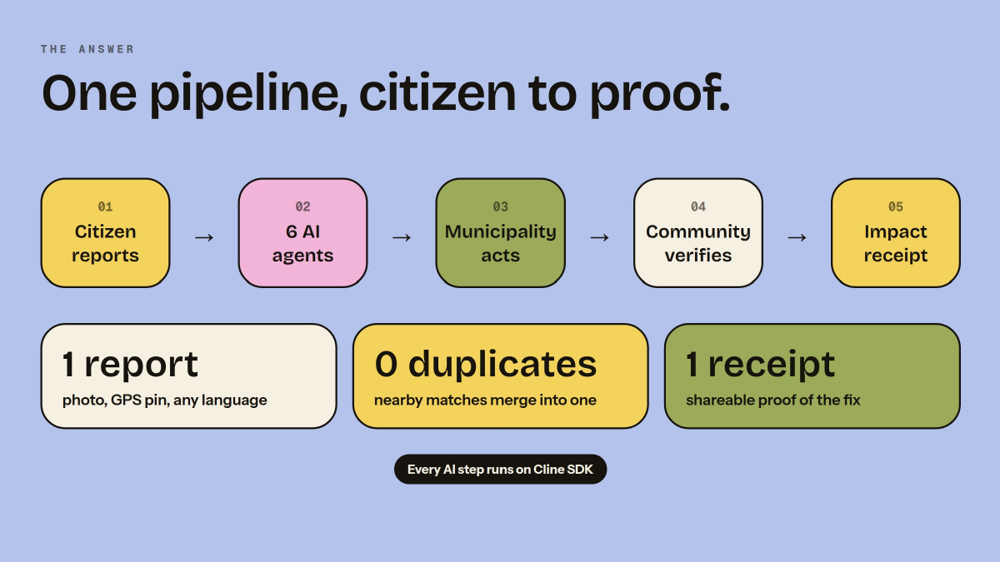 | 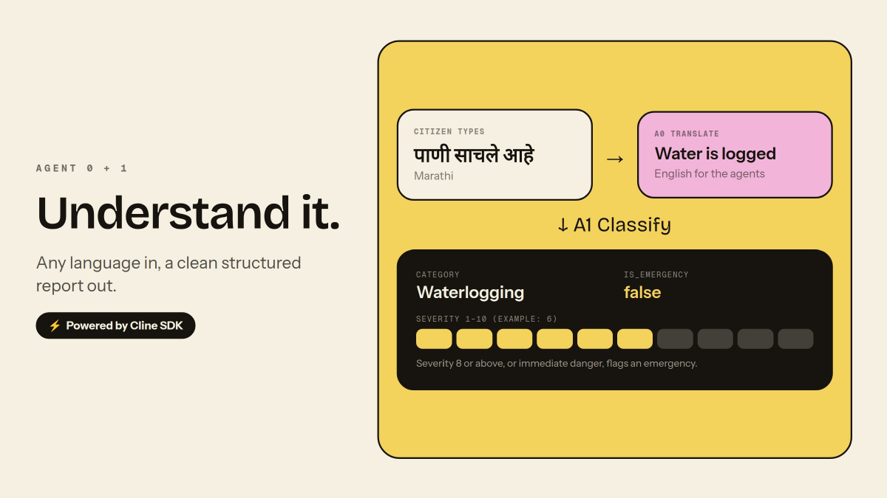 |
| 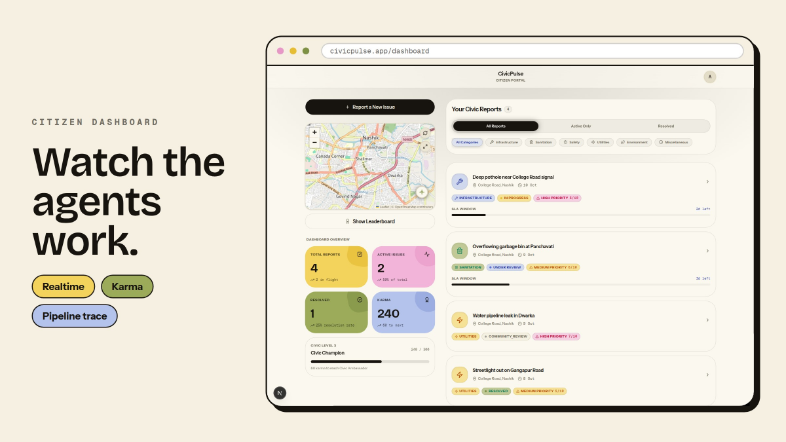 | 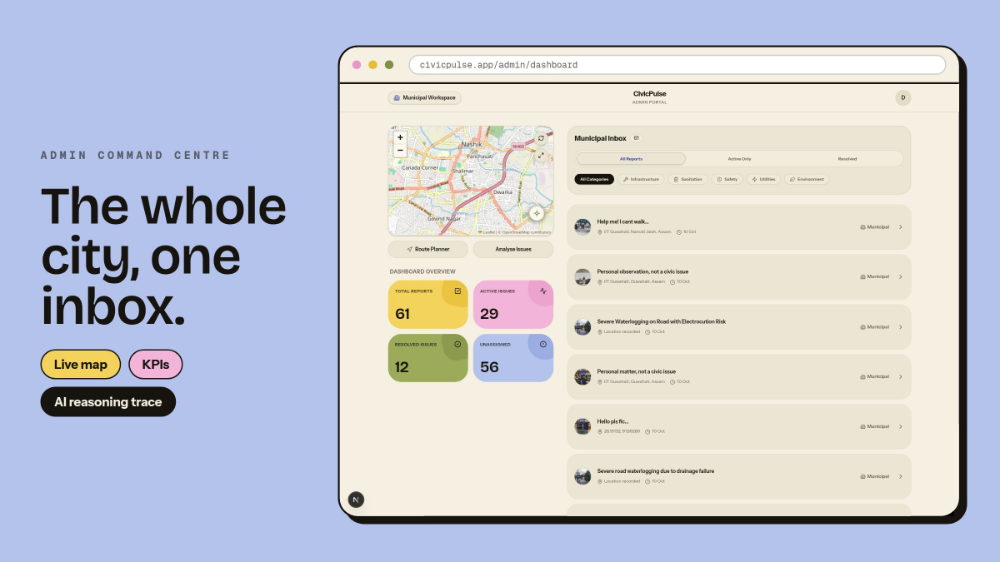 |
| 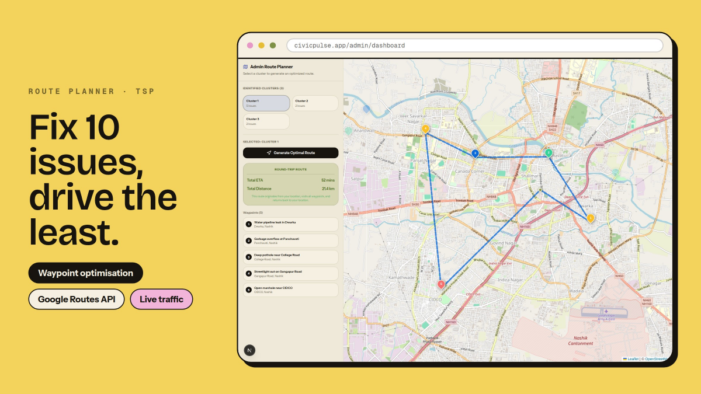 | 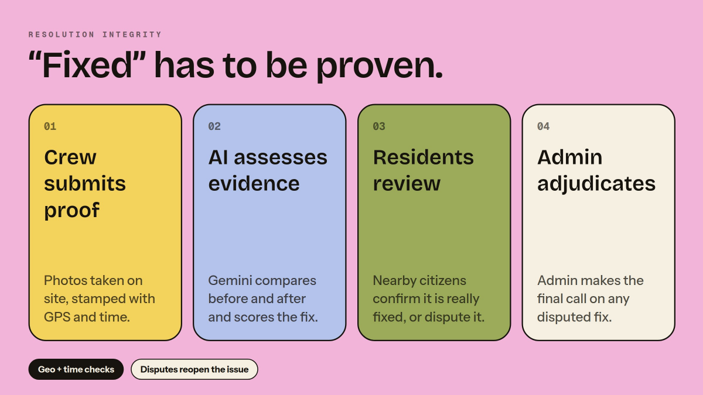 |
| 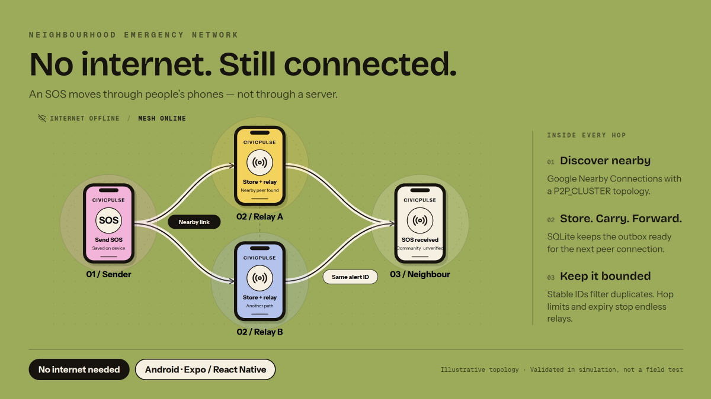 | 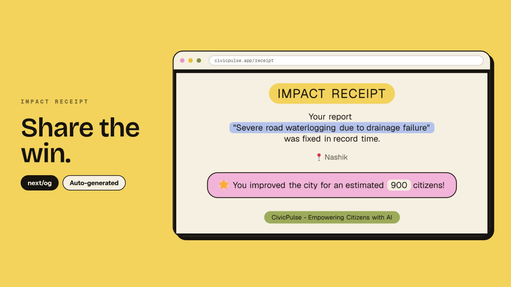 |

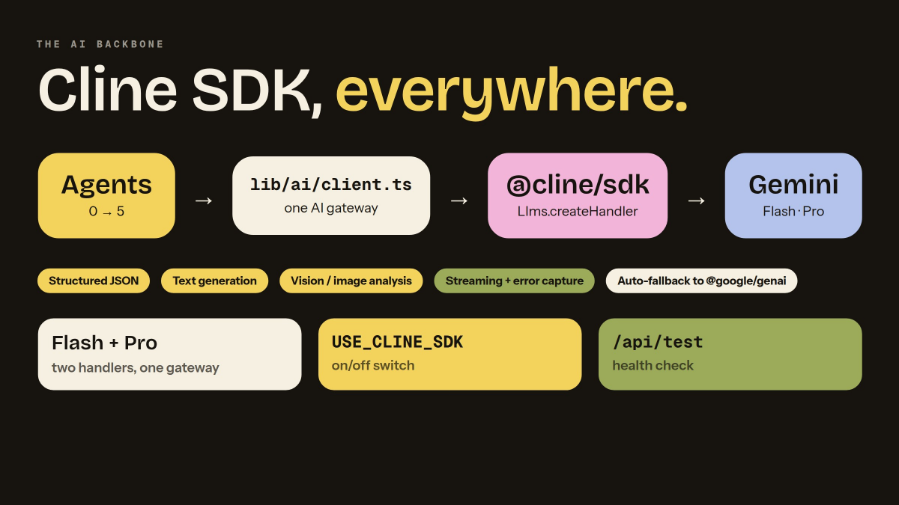

### Mobile: Offline SOS

The mobile app can send an SOS or hazard alert with no internet. Alerts are saved on the phone and relayed to nearby phones. They are community reports, not official warnings.

| 1. Home: "Offline alerts" quick access | 2. You: "Offline emergency alerts" | 3. Relay, SOS and Hazard |
|---|---|---|
| 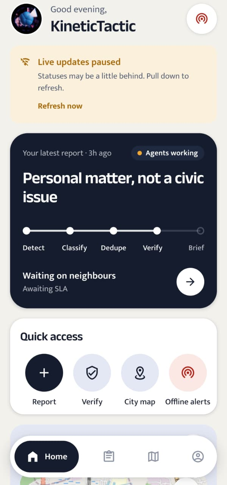 | 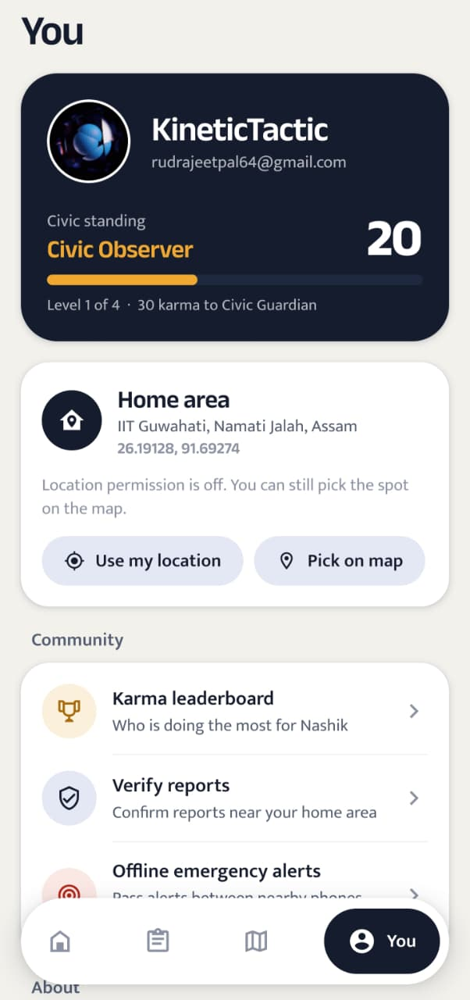 | 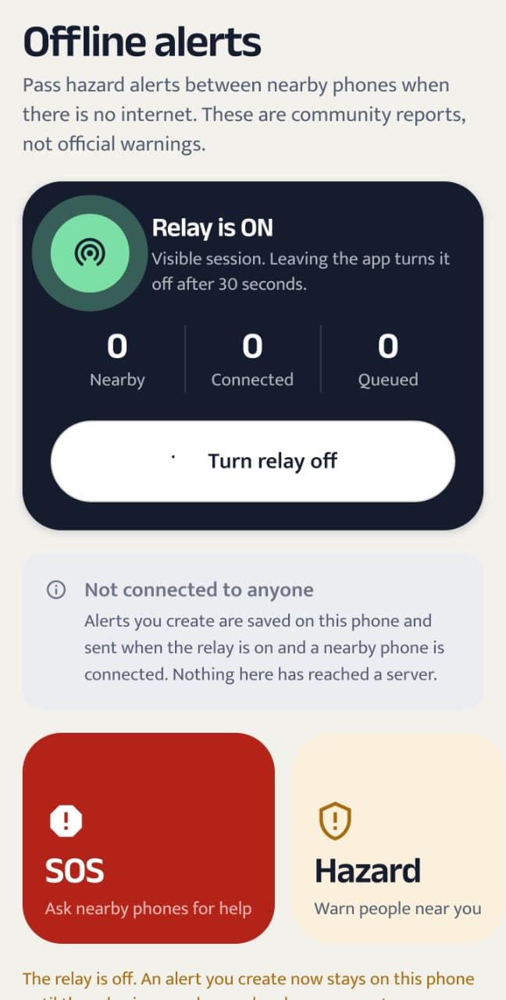 |

---

## System Architecture

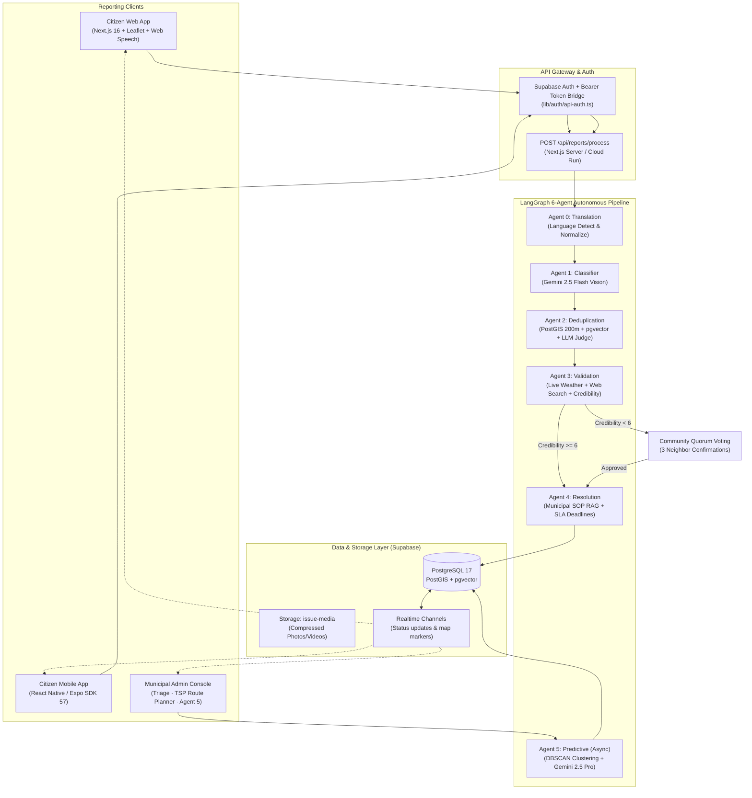

---

## The 6-Agent LangGraph Pipeline

Every report flows through an autonomous `StateGraph` with state persistence, error boundaries, and pause/resume checkpoints:

| Agent | Technology | Function |
|---|---|---|
| **Agent 0: Translation** | Gemini 2.5 Flash | Auto-detects input language (Hindi, Marathi, English, etc.) and standardizes to English while preserving original text and translation trace. |
| **Agent 1: Classifier** | Gemini 2.5 Flash Vision | Multi-modal inspection of text + image/video evidence. Extracts category, subcategory, severity score (`1-10`), emergency triage flag, and assigns target municipal department. |
| **Agent 2: Deduplication** | PostGIS + pgvector + Gemini | **3-Layer Defense:**<br>1. *Spatial:* PostGIS `ST_DWithin` (200m radius).<br>2. *Semantic:* pgvector cosine similarity (threshold >= 0.85).<br>3. *LLM Judge:* Gemini evaluates visual and descriptive nuance to merge duplicates into clusters without duplicate worker fatigue. |
| **Agent 3: Validation** | ReAct + Open-Meteo + Web Search | Gathers live meteorological data (rainfall/temperature) and DuckDuckGo search context. Computes a credibility score (`1-10`). Issues scoring `< 6` are paused into `community_review`. |
| **Agent 4: Resolution** | Gemini 2.5 Flash + pgvector RAG | Queries vectorized municipal SOPs (`civic_sops.json`) to generate actionable **150-200 word Civic Action Briefs** in English and local languages, setting strict SLA deadlines. |
| **Agent 5: Predictive** *(Async)* | Gemini 2.5 Pro + DBSCAN | Analyzes historical issue clusters using spatial Haversine greedy clustering to forecast recurring infrastructural failure zones and generate proactive alerts for urban planners. |

---

## Web Frontends

Built with **Next.js 16 (App Router)**, **Tailwind CSS v4**, **shadcn/ui**, and **Framer Motion**.

### 1. Citizen Portal
- **Landing Page (`/`)**: Dynamic hero, instant status lookup, and dual-track entry (Citizen vs. Municipality).
- **Multi-Modal Report Engine (`/report`)**:
  - **Voice Dictation**: Hands-free reporting powered by the browser Web Speech API.
  - **Media Capture**: Live webcam integration and direct photo/video file uploads with Supabase Storage integration (`issue-media`).
  - **Interactive Geolocation**: Browser GPS auto-detection with Leaflet interactive pin-drop and Google Maps reverse geocoding.
- **Citizen Dashboard (`/dashboard`)**:
  - **Realtime Issue Tracker**: Live updates via Supabase WebSockets showing real-time agent progression (`Agent 0` -> `Agent 4`) and SLA countdowns.
  - **City Incident Map**: Interactive Leaflet/OpenStreetMap visualizer rendering verified issues and active clusters across the municipality.
  - **Community Verification Queue**: Hyperlocal verification feed displaying unverified reports within 1 km of the user's home location for community quorum voting.
  - **Karma Leaderboard**: Real-time civic reputation rankings awarding points (+10 for reporting, +2 for verification, +50 for confirmed resolutions).
- **Dynamic Impact Receipts (`/receipt/[issue_id]`)**: Auto-generated OpenGraph shareable cards (via Next.js `@vercel/og` Edge runtime) highlighting verified civic fixes.

### 2. Municipal Admin Console
- **Role-Guarded Security (`/admin/dashboard`)**: Enforced at edge proxy (`proxy.ts`) and server level for verified administrative accounts.
- **Civic Triage Inbox**: Filterable operational table with full-text search, department assignments, SLA breach warnings, and batch status mutations.
- **AI Reasoning Inspector**: Complete transparency drawer displaying raw agent reasoning chains, weather validation telemetry, deduplication similarity scores, and SOP match references.
- **TSP Route Planner (`/api/admin/routes/optimize`)**:
  - Groups pending field issues into spatial clusters.
  - Solves the Traveling Salesperson Problem (TSP) using **Google Maps Routes API** (`optimizeWaypointOrder: true`).
  - Outputs turn-by-turn navigation paths and travel time estimates for municipal repair crews.
- **Predictive Hotspot Panel**: Admin-triggered Agent 5 execution visualizing future risk zones and structural degradation patterns.

---

## Native Mobile App (React Native / Expo)

Located in `mobile/`, the native Android client shares the same Supabase database, storage buckets, and Next.js backend endpoints; built with 100% native primitives, not a WebView wrapper.

### Mobile Features
- **Shared Domain Typing**: Zero contract drift by importing types directly from `lib/db/types.ts` at build time.
- **Native Session Storage**: Android Keystore integration via chunked `SecureStore` (handling tokens > 2 KB) with fallback support.
- **Deep-Link Authentication**: Email magic-link and OTP deep linking (`civicpulse://auth-callback`) plus Google PKCE OAuth.
- **Smart Bandwidth Optimization**: Client-side image manipulation downscaling camera photos to 1600 px at 0.7 JPEG quality before upload.
- **Precision Pinpoint Picker**: Interactive map picker paired with a 55 m directional arrow-pad for exact pin adjustment even in poor connectivity.
- **Offline Drafts**: Debounced auto-save into `AsyncStorage` ensuring interrupted submissions are never lost.
- **Signature Pipeline Motif**: Native `PipelineRail` and `PipelineTimeline` components mirroring real-time multi-agent execution.
- **Municipality Status Gateway**: Admin-restricted screen with live operational counters (overdue SLAs, quorum waits, pipeline health) and web console handoff.

---

## Technology Stack

| Layer | Technologies |
|---|---|
| **Web Frontend** | Next.js 16.2.9 (App Router, Turbopack), React 19, Tailwind CSS v4, shadcn/ui, Framer Motion, Leaflet |
| **Mobile App** | React Native 0.86, Expo SDK 57, Expo Router, Reanimated 4, React Native Maps |
| **AI & Orchestration** | LangGraph (`@langchain/langgraph`), Google Gemini 2.5 Flash / Pro, Gemini Embedding (768-dim), Ollama (optional) |
| **Backend & APIs** | Next.js API Routes, Google Maps Geocoding & Routes APIs, Open-Meteo Weather API |
| **Database & Auth** | Supabase (PostgreSQL 17, PostGIS, pgvector, Realtime, Storage, Auth with Google OAuth & Magic Link) |
| **Infrastructure & CI/CD** | Google Cloud Run (Docker multi-stage, `asia-south1`), GitHub Actions Workload Identity Federation |
| **Package Manager** | [Bun](https://bun.sh/) (root & mobile) |

---

## Getting Started

### Prerequisites

- [Bun](https://bun.sh/) (v1.1+) installed
- [Node.js](https://nodejs.org/) (v20+) installed
- A [Supabase](https://supabase.com/) project with **PostGIS** and **pgvector** extensions enabled
- API Keys: [Google AI Studio](https://aistudio.google.com/app/apikey) (Gemini), [Google Cloud Console](https://console.cloud.google.com/) (Maps Geocoding & Routes)
- *(For mobile)* Android Studio & Android Emulator or physical device with Expo Go

---

### 1. Backend & Web App Setup

```bash
# 1. Clone the repository
git clone https://github.com/your-org/civic-pulse.git
cd civic-pulse

# 2. Install dependencies using Bun
bun install

# 3. Configure environment variables
cp .env.example .env.local
# Edit .env.local with your Supabase, Gemini, and Google Maps API keys

# 4. Seed the Municipal SOP Knowledge Base (for Agent 4 RAG)
bun run scripts/seed-knowledge-base.ts

# 5. (Optional) Seed synthetic demo issues for Nashik
bun run scripts/seed-nashik-issues.ts

# 6. Start the development server
bun dev
```

The web application will be live at **`http://localhost:3000`**.  
Verify your configuration anytime by visiting `http://localhost:3000/api/test`.

---

### 2. Mobile App Setup

The mobile app connects directly to your running local backend or Cloud Run deployment.

```bash
# 1. Navigate to the mobile directory
cd mobile

# 2. Configure mobile environment
cp .env.example .env.local
```

In `mobile/.env.local`, set:
- `EXPO_PUBLIC_SUPABASE_URL` & `EXPO_PUBLIC_SUPABASE_ANON_KEY` (same as web app)
- `EXPO_PUBLIC_API_URL`:
  - **Android Emulator**: `http://10.0.2.2:3000` (points to host machine)
  - **Physical Device**: `http://<YOUR_LOCAL_IP>:3000`
  - **Production**: `https://<YOUR_CLOUD_RUN_URL>`

> [!IMPORTANT]
> **Supabase Redirect Configuration:**  
> Add `civicpulse://auth-callback` (and `exp://**` for Expo Go) to your **Supabase Dashboard -> Authentication -> URL Configuration -> Redirect URLs**.

```bash
# 3. Install mobile dependencies
bun install

# 4. Run on Android
bun run android

# Or start the Expo Metro bundler
bun run start
```

---

## Environment Configuration

### Root (`.env.local`)

```ini
# Supabase
NEXT_PUBLIC_SUPABASE_URL=https://your-project.supabase.co
NEXT_PUBLIC_SUPABASE_ANON_KEY=eyJhbGciOi...
SUPABASE_SERVICE_ROLE_KEY=eyJhbGciOi...

# AI Models (Gemini)
GEMINI_API_KEY=AIzaSy...
AI_PROVIDER=gemini
GEMINI_AGENT5_MODEL=flash

# Google Maps Platform (Geocoding & Routes APIs enabled)
GOOGLE_MAPS_API_KEY=AIzaSy...
NEXT_PUBLIC_GOOGLE_MAPS_API_KEY=AIzaSy...

# Application URL
NEXT_PUBLIC_APP_URL=http://localhost:3000
```

### Mobile (`mobile/.env.local`)

```ini
EXPO_PUBLIC_SUPABASE_URL=https://your-project.supabase.co
EXPO_PUBLIC_SUPABASE_ANON_KEY=eyJhbGciOi...
EXPO_PUBLIC_API_URL=http://10.0.2.2:3000
EXPO_PUBLIC_AUTH_REDIRECT=civicpulse://auth-callback
EXPO_PUBLIC_GOOGLE_MAPS_KEY=  # Optional: Android Google Maps SDK key
```

---

## Deployment

CivicPulse is containerized for production and optimized for **Google Cloud Run**:

```bash
# Build standalone Docker container
docker build -t gcr.io/<PROJECT_ID>/civicpulse:latest \
  --build-arg NEXT_PUBLIC_SUPABASE_URL="<YOUR_SUPABASE_URL>" \
  --build-arg NEXT_PUBLIC_SUPABASE_ANON_KEY="<YOUR_ANON_KEY>" \
  --build-arg NEXT_PUBLIC_APP_URL="<YOUR_PRODUCTION_URL>" .

# Deploy to Cloud Run (asia-south1)
gcloud run deploy civicpulse \
  --image gcr.io/<PROJECT_ID>/civicpulse:latest \
  --platform managed \
  --region asia-south1 \
  --allow-unauthenticated
```

CI/CD is automated via `.github/workflows/deploy-prod.yml` using Google Workload Identity Federation on pushes to the `prod` branch.

---

## License

This project is licensed under the MIT License. See the [LICENSE](LICENSE) file for details.
